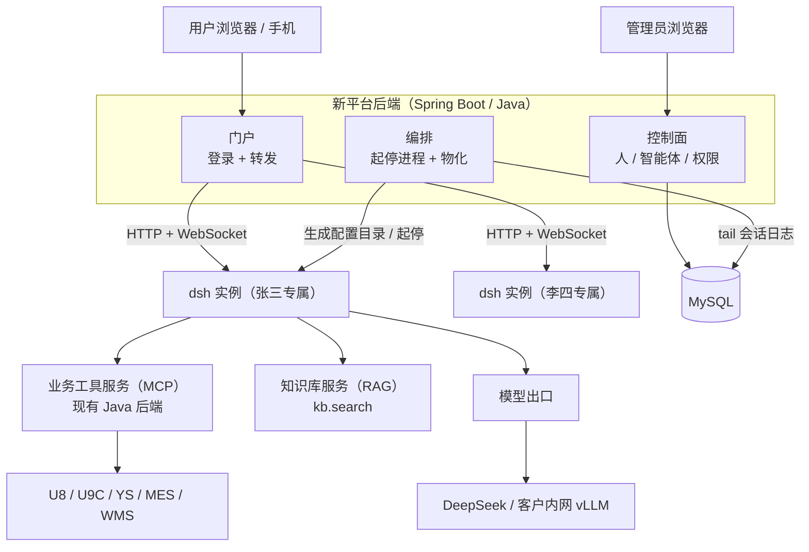
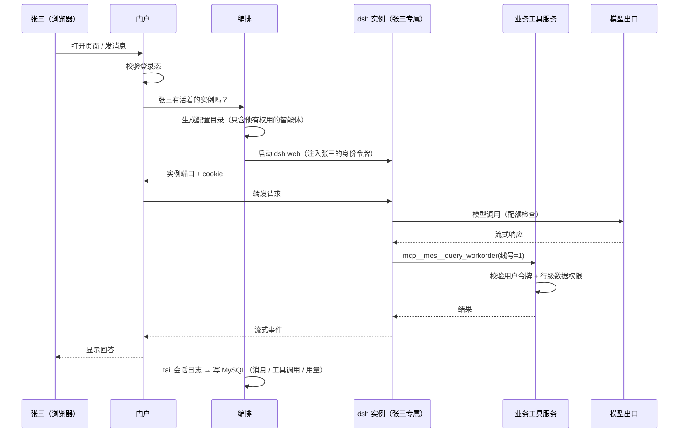
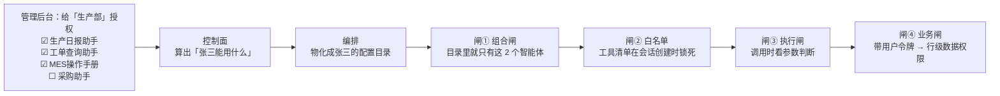

# 企业 Agent 平台架构评估 v2（DSH 运行时 + 私有化交付）

> v2 依据你们已确认的六条决策重写：① 不管 Dify；② 新平台前后端重新搭建；③ 私有化交付；④ DSH 的 Web GUI 作为聊天入口；⑤ 权限粒度＝组织层级/人员 × 资源（智能体、技能、提示词）；⑥ 与现有 agent-chat-ui 无关。
>
> v3 追加：⑦ 新后端全新起、MVP 优先、暂不与 MOM 同步（预留同步接口）；⑧ 规模暂不确定 → 进程模型做成可配置 + P0 实测反推容量；⑨ 模型优先 DeepSeek、可能混用 → 出口按路由分开计价；⑩ 团队接受 React + TS → **新平台全 TypeScript**（判断 8）；⑪ 手机端可行性已有结论（判断 7 末节）。
>
> **结论先行**：DSH 当**执行内核**，你们建**控制面 + 数据面 + 门户**。
> DSH 是"本地优先、单用户、单进程、单 `$DSH_HOME`"的工程工具——`dsh web` 连 `0.0.0.0` 都在启动时拒绝绑定，唯一的认证是进程级 token（官方原话：*a confused-deputy defense rather than identity*）。所以"给 DSH 加登录"这条路不通。

---

## 一张图先看懂



### 一条消息的旅程



### 权限的四道闸



---

## 〇、名词解释（先说清楚这几个词，后面不容易糊）

我前一版把三个不同的东西都叫"网关"，这是我的问题。逐个说清楚：

### 1. 运行时编排服务（原"Agent 运行时网关"）

**它解决的问题**：DSH 本体是个命令行程序。`dsh --profile sdk` 启动后只会"从标准输入读一行 JSON-RPC，往标准输出吐事件"——它不认识 HTTP、不认识你们的用户、不会自己按用户切换配置、也不会自己启停。

这个常驻服务就是它的"保姆 + 翻译 + 池子"：

- 用户第一次打开聊天 → 按这个用户生成一份配置目录（能用哪些智能体/技能/提示词）+ 拉起一个 dsh 进程
- 把浏览器来的消息翻译成 dsh 听得懂的 JSON-RPC
- 把 dsh 吐的事件流翻译成 SSE/WebSocket 推给浏览器
- 用户点"停止" → 把进程杀掉（**DSH 没有取消接口，杀进程就是取消**；会话已落盘，可恢复）
- 用户长时间不用 → 回收进程

一句话：**DSH 进程池 + 配置生成器 + 协议翻译器**。这一层没有现成的，必须写。

### 2. 业务工具服务层（原"MCP 网关"）

**你们已经有了**（`api/v1/agent/mcp`）。它做的事：所有业务工具的**唯一入口**——"这个用户能不能调这个工具"、"参数对不对"、"写操作要不要审批"、"记审计"。

要改的只有一点：现在它认的是"每个 agent 一个密钥"（`mcp_agent_credential`），要改成"**每个用户一个短期令牌**"，这样它才知道"这次查询是谁发的"，才能套用你们已有的数据权限。

### 3. 模型出口（原"模型网关"）

所有大模型调用的**唯一出口**。存在的理由有三个：

- DSH **不感知"谁在花钱"**，配额只能在这里拦
- 私有化时模型可能来自 DeepSeek 官方 API，也可能来自客户内网的 vLLM，出口统一后换模型不动 DSH
- 密钥不落进每个用户的配置目录

### 4. 认证门户 + 反向代理（新角色，因为你选了 DSH GUI 当聊天入口）

就是你们新平台的后端。负责登录，然后把每个用户的 HTTP/WebSocket 请求转到他**自己那个** `dsh web` 实例上。DSH 自己的 token 只留在服务器上，用户手里只有你们平台的登录态。

### 5. 物化（materialization）

把数据库里的授权结果，**变成磁盘上的文件和环境变量**。

为什么必须这么做：DSH 的能力是"**组合**出来的"，不是"运行时查库决定的"——一个智能体能用什么工具，取决于它的预设文件里挂了哪些插件行。所以"张三能用 A、B 两个智能体"这件事，落地形态就是"给张三生成的配置目录里只有 A、B 两个预设"。

### 6. 预设（Preset）

DSH 里"一个智能体定义"的落地形态：一个目录 + 一个 `agent.cordis.yml`，里面写着这个智能体挂哪些工具、哪些技能、哪段提示词。**你们产品里的"智能体"直接映射到它。**

### 7. 授权快照（entitlement snapshot）

一份 JSON："这个用户能用哪些智能体、哪些技能、哪些提示词模板、哪些业务工具、多少配额"。它是**控制面和运行时之间唯一的契约**——控制面负责算，编排服务负责照着物化。

---

## 一、DSH 能白拿的

| 能力 | 说明 |
|---|---|
| Agent 循环 | step/turn 生命周期、工具管道、重试、流式 |
| 会话日志 | 只追加、版本化（当前 `SESSION_FORMAT_VERSION = 3`）、相邻迁移、`deriveMessages()` 投影模型历史 |
| 提示词装配 | `ctx.systemPrompt` 分区 + 变量 + persona 前缀/后缀，可按智能体覆盖 |
| 技能 | 分层注册表 + 目录发现 + 会话内目录 + `skill` 工具按需加载 |
| MCP 客户端 | stdio / streamable-http，一服务一行配置，工具名 `mcp__<server>__<tool>`，自动重连 |
| 模型接入 | DeepSeek 直连；`llm-pi-ai` 支持手工声明的 OpenAI 兼容网关（私有化 vLLM 可行） |
| 子代理 / 工作流 | `subagent`（可续跑）、`workflow`（模型写 JS 编排）、`goal`、`todo`、`schedule` |
| 附件 / 文件 / 沙箱 | 内容寻址附件存储、文件工具、输出外溢、`ctx.sandbox` |
| 用量（token） | `assistant/message.usage`：精确的 input/output/cacheRead/cacheWrite/reasoning tokens；另有 `sessionStats`（轮数、步数、llmMs、ttftMs） |
| **Web GUI** | **自带中文**（内置 `zh`/`en` 两套字典，按浏览器语言自动切）——这是选它当聊天入口的前提 |
| 嵌入方式 | SDK：stdio 上的 JSON-RPC（3 请求 + 4 通知） |

---

## 二、DSH 明确没有的（必须自建）

1. **身份与登录**：没有任何用户概念。唯一认证是进程级 token → 签名 cookie，**一个进程只有一个身份、没有登出**。
2. **多租户/多用户隔离**：一个进程读一个 `$DSH_HOME`（sessions / settings / credentials / storage 全是 home 级单例）。**同一进程里，任何拿到 cookie 的浏览器连接能列出并驱动所有会话**。
3. **授权 / ACL**：IPC 上没有任何"谁在调用"的概念。官方文档原话：Host 契约 *assumes a trusted caller boundary*。
4. **配额 / 计费**：全仓库**没有任何成本或单价概念**；没有按用户/租户的限额；没有 LLM 请求门控钩子；自带 telemetry 后端是 `FEEDBACK_ONLY`，不是计量通道。
5. **RAG / 向量检索**：没有 embedding、向量库、rerank、文档切分。
6. **提示词模板库**：官方明确 *"there is no end-user prompt-editing API"*。
7. **人工审批流**：只有一次性 allow/reject，且**必须要有一个 answerer**，否则 fail closed；SDK 通道上跑不通。
8. **会话运维**：没有删除/保留策略 API，没有宿主侧导出接口，`list()` 不分页不过滤。
9. **企业部署形态**：没有 TLS、没有反向代理头处理、没有审计身份，`--host 0.0.0.0` 被拒绝（**只能 127.0.0.1，正好由门户代理转发**）。

---

## 三、你们已有的家底（哪些继续用）

| 资产 | 处置 |
|---|---|
| `sysr_*` RBAC + 多租户 + 多应用 | **继续用**，作为新平台账号/组织模型的设计蓝本；新平台自建库，做同步或 SSO |
| `sysr_datarule` 行级数据权限 + 列权限 | **继续用**，落在业务工具服务层，管"能看哪些工单" |
| 自研 MCP server（`api/v1/agent/mcp`，~15 工具）+ `mcp_tool_audit` | **继续用**，改造身份口径 + 工具分级 |
| `agent/automation/purchase`（draft→confirm） | **继续用**，作为写操作审批的范本推广 |
| ERP/MES/WMS 业务接口 | **继续用**，是被 agent 调用的能力来源 |
| Dify | **不用了**（按决策①）→ RAG 需自建 |
| `agent-chat-ui` | **不用了**（按决策⑥）→ 聊天入口是 DSH GUI |
| `agent_conversation*` 对话表 | 可作镜像目标的参照，新平台建自己的表 |

---

## 四、七个关键设计判断

### 判断 1：一个用户一个 DSH 实例

私有化交付下，**不能一个客户（租户）共用一个 DSH 进程**，因为：

- GUI 会列出该进程的**所有**会话 → 客户内部不同组织/人员互相看得见聊天记录
- 预设清单是进程级的 → 没法让"张三只能用 A、李四只能用 B"

所以即使私有化，也是**每用户一个 `dsh web` 实例**（不是每租户）。用**空闲回收**控制资源：只有活跃用户有常驻进程。

进程模型对照：

| 模型 | 会话隔离 | 权限可落地 | 资源 |
|---|---|---|---|
| 每用户一实例 | ✓ | ✓ | 活跃用户数 × 进程 |
| 每租户一实例 | ✗ 租户内互见 | ✗ | 最低 |

⚠️ **取消 = 杀进程**（SDK 没有 cancel/close）。会话日志持久化，杀掉可恢复——"停止生成"就按这个语义做。

⚠️ **进程内存与启动耗时必须实测**。这是 P0 打样的头号目标，也是规模未知时的唯一解法。

**规模不确定怎么办**：不要现在猜，把进程模型做成**配置项**，P0 测出单实例成本后反推容量。

| 单实例常驻内存 | 20 并发 | 50 并发 | 100 并发 |
|---|---|---|---|
| 150 MB | 3 GB | 7.5 GB | 15 GB |
| 300 MB | 6 GB | 15 GB | 30 GB |
| 500 MB | 10 GB | 25 GB | 50 GB |

（这是"全部常驻"的上界。用空闲回收后，常驻数 ≈ **活跃用户数**，不是账号数。）

P0 要测出三个数：**单实例常驻内存**、**冷启动耗时**（决定用户要不要等，进而决定要不要预热池）、**单个会话一轮的峰值内存**。

编排服务要预留这些配置：最大常驻实例数、空闲回收时长、预热池大小、单实例并发会话上限、单轮超时。换句话说：**先做成能调，再决定调到哪。**

### 判断 2：权限 = 组合 + 白名单 + 业务层，四道闸

你的要求是"控制某些组织层级/人员可以访问哪些智能体、哪些技能、哪些提示词"。这在 DSH 里的落地方式是**四道闸**：

| 闸门 | 做什么 | 对应你的需求 | 强制力 |
|---|---|---|---|
| ① 组合闸（物化） | 给这个用户生成的配置目录里**只放**他有权用的智能体/技能/提示词 | "张三只能用 A、B 两个智能体" | 强（没有就没有） |
| ② 注册表白名单 | 私有插件在会话创建窗口调 `tools.restrict({ allow: [...] })` | "这个智能体里只能调这三个工具" | **强**：同一个视图同时喂工具清单（模型看不见）和调用派发（调不到） |
| ③ 执行闸 | `tools/pre-execute` 瀑布（**能拿到工具参数**） | "只能查本车间"这类参数级规则 + 配额拦截 | 强 |
| ④ 业务闸 | 业务工具服务层按用户令牌 + 你们现成的行级数据权限校验 | "只能看自己负责的工单" | 强（最终裁判） |

**四个必须知道的坑**：

1. DSH 的预设清单**没有 per-user 白名单**：任何预设 id 都能被选中，`trust` 只决定"能不能改/删"、不决定"能不能挂载"。官方原话 *"Treat every authored preset as trusted configuration"*。
   → **关掉内置预设根目录和用户可写根目录，预设全部由你们物化。**
2. 工具白名单**只接受精确工具名，不支持通配**，且对未注册的名字会抛错；MCP 工具是启动后异步发现的。所以"同一个业务服务里只授权部分工具"要在初始化完成后**枚举 `mcp__*` 再 restrict**。
3. **技能没有"删除/隐藏"API**，只能 shadow 同名。技能隔离靠"每个智能体挂自己的技能目录"，再配合把 `skill` 工具 restrict 掉（`skill` 工具被 restrict 时技能目录会自动从提示词消失——这条是强制生效的）。
4. **DSH 默认配置带 Bash、文件写入等工具。面向业务用户必须组合掉**，这是事故高发点。

**授权的继承规则**需要你们定：组织层级是否向下继承？角色和用户例外谁优先？（建议：组织继承 + 角色叠加 + 用户级例外，且"拒绝"优先于"允许"。）

### 判断 3：会话日志是运行时真相，业务库只做只读镜像

| 方案 | 评价 |
|---|---|
| 实现 `SessionPersistence` 后端直接写你们的库 | **不建议**。上游只提供纯校验函数、没有基类，handle 语义 / 单写者记账 / 事件路由全要自己写；**一个上下文只能有一个持久化后端，不能与 JSONL 共存**；还得自己维护相邻迁移链（已提交世代永不改名/覆盖/删除） |
| 保留 DSH 的 JSONL 作为运行时工作存储 + 镜像管道（**推荐**） | 编排服务/插件订阅会话事件流，异步入业务库（消息行 / 工具调用行 / 用量行）；定期全量对账 |

铁律：**永远不要试图用业务库里的消息去"喂"模型**。DSH 的模型历史只能从它自己的日志投影出来。

### 判断 4：业务工具走 MCP，你们已经赢在这条线上

你们已有无状态 Streamable HTTP 的 MCP server，DSH 一行配置就能接：

```yaml
- id: mcp-mom
  name: '@deepseek-ai/dsh-mcp-client'
  config:
    serverName: mom
    transport: streamable-http
    url: http://backend:8080/api/v1/agent/mcp
    headers:
      X-Dsh-User-Token: !!js '`${process.env.DSH_AGENT_USER_TOKEN}`'
```

**身份口径要改**：从"每 agent 一个密钥"改成"**每用户一个短期 JWT**"

- 编排服务在启动该用户的实例时注入 `DSH_AGENT_USER_TOKEN`
- 业务工具服务层解析出 `userId + tenantId + orgId`，塞进你们现有的安全上下文
- 然后行级数据权限原样生效——**这一层你们已经写完了，不用重写**

这就是"一个用户一个实例"最硬的技术理由：**进程环境是唯一干净的身份载体**（把 userId 放在工具参数里是模型可控的，绝对不行）。

### 判断 5：审批做在业务侧

DSH 的审批是"一次性 allow/reject + 必须要 answerer + fail closed"，SDK 通道上跑不通。而你们有现成范本（采购 draft→confirm）：

- **只读查询**：直通，不审批
- **写操作**（下单、改工单、报工）：业务工具服务层内"预登记 → 人工确认 → 幂等执行 → 回执"，agent 只看到"已提交待审批"
- 审批渠道：钉钉/企业微信/新平台后台

### 判断 6：用量采集走会话事件镜像，配额拦截放模型出口

- DSH 给**准确的 token**（`assistant/message.usage`，各字段互不重叠），但**没有任何成本/单价** → 价格表你们自己建
- `token-meter` 的估算是"参考值不是账单"（4 字符/token 的启发式，中文严重低估）→ **只用于上下文占用显示，不要用于计费**
- 采集：复用判断 3 的镜像管道即可（事件流里本来就带 usage），**不必单独写用量插件**
- 拦截：**模型出口是唯一干净、不可绕过的一层**；门户再做一次粗粒度预检（余额不足不让发）

### 判断 7：聊天入口用 DSH GUI —— 可行，但有一个硬约束和一个新角色

**硬约束**：必须一个用户一个 `dsh web` 实例（理由见判断 1）。

**新角色：认证门户 + 反向代理**（你们新平台的后端）。它做四件事：

1. 用户登录（你们自己的账号体系）
2. 为该用户拉起/复用他自己的 `dsh web` 实例（监听 `127.0.0.1` 随机端口）
3. 捕获启动时打印的 `?token=` 授权 URL，换取并**持有** DSH 的 cookie
4. 把浏览器的 HTTP 与 WebSocket（`/api/remote.mux`）请求代理到该实例，代填 cookie

**要处理的细节**（P0 就要验证）：

- DSH 的 cookie 与 Host 绑定 → 给实例配置 `trustedHosts` 加上门户域名，代理保留 Host 与 `sec-fetch-site: same-origin`
- `--host` 只能是 `127.0.0.1`（`0.0.0.0` 被启动拒绝）→ 只能由同机门户转发，**这正好符合私有化内网**
- WebSocket 升级必须代理（不代理就只有首屏、没有流式）
- 好处：**DSH 的 token 永不离开服务器**；用户在门户里被停用 → 立刻断掉代理，访问即刻失效

**要提前知道的四个代价**：

1. **定制 UI 要写 React 客户端插件**（DSH GUI 是 React + slots 体系，不是 Vue）。品牌、引用卡片、用量条、审批按钮都属于这里。**你们是 Vue 栈，这是一块新技能面**——P0 可以先零定制。
2. **移动端（uni-app）用不了 DSH GUI** → 移动端要么只做查询/审批轻页面，要么以后自建聊天前端。
3. **DSH 升级可能改 GUI**，定制插件要跟着维护。
4. GUI 自带的入口（插件管理、模型设置、权限预设切换、目录选择器）对业务用户是噪音甚至风险，需要用配置关掉或组合掉。**上线前要做一次"面向最终用户的 UI 收敛"。**

**建议**：P0 用"门户代理 + 原生 DSH GUI（中文）"最快跑通；把"是否自建聊天前端"推迟到 P2 结束再决定——那时你们已经知道用户真正需要什么。

#### 手机能用吗？——能，但要真机实测

我去代码里核对了，不是猜：

- 页面声明了移动端视口：`<meta name="viewport" content="width=device-width, initial-scale=1">`，并且带 PWA manifest
- 布局按视口宽度自适应：窄屏自动收起侧栏；右栏在 **<768px 自动全屏**；散落着 480 / 560 / 680 / 720 / 760 / 767px 等断点
- **有触摸适配**：`@media (pointer: coarse)` 把可点区域放大到 44px（附件、交付物列表等）；只用 hover 才出现的操作有 `@media (hover: hover)` 守卫，手机上不会变成"看不见也点不到"

**但它是"自适应的桌面 GUI"，不是"为手机设计的界面"。** 手机上的风险点：

- 多栏停靠 / 拖拽分栏 / 工作区标签页——窄屏虽会禁用分栏，操作仍别扭
- 轨迹视图是"缩放 + 平移的时间轴表格"，手机上基本没法用
- 文件树、文档预览、终端这些右栏功能在手机上没意义
- 输入框的 `@文件` 引用、斜杠命令在软键盘下的表现未知
- 长回复的复制、中文输入法候选框与流式刷新是否打架——未知

**嵌入方式**：uni-app 用 `<web-view>` 直接加载门户 URL 即可（同域 HTTPS，cookie 与 WebSocket 都正常）。

**建议**：P0 打样加一项**真机实测**（登录 → 选智能体 → 发消息 → 看流式 → 中文输入 → 审批）。如果移动端只需要"聊天 + 审批"，大概率够用；如果不够，就做移动端精简页——**这个成本不高**，因为编排服务已经暴露了事件流接口，前端随便换。**别在没实测前就承诺"手机端体验好"。**

### 判断 8：**以 Java 为主**，TypeScript 只出现在必须的地方

（这条我改过结论。上一版按"类型共享"推荐全 TS，忽略了"一个人扛项目"这个约束。下面是对上手的评估。）

| 组件 | 建议栈 | 理由 |
|---|---|---|
| 控制面（组织/人员/角色/智能体/技能/模板/授权） | **Spring Boot 3 + Java** | 纯 CRUD + 权限，你们的主场，速度差一倍 |
| 门户（登录 + 反向代理） | **Spring Cloud Gateway / WebFlux** | HTTP + WebSocket 转发是现成能力 |
| 编排服务（进程池 + 物化 + 驱动 dsh） | **Spring Boot + Java**，自己写一个薄客户端 | 唯一"用 Node 更顺"的地方，但代价可控（见下） |
| DSH 侧插件（策略白名单 / 模板注入） | **TS + Cordis（必须）** | 它跑在 dsh 进程内部，没有别的选择；只有 2 个小插件，量很小 |
| 管理后台 | **Vue 3** | 你们熟，没有理由换 |
| 聊天界面 | DSH GUI（现成） | 零开发 |
| DSH GUI 深度定制（品牌/引用卡片/审批按钮） | React + TS（P3 以后） | 可推迟，真要做时再学或外包 |
| 业务工具服务层 | Java（现有后端） | 不动技术栈 |

**为什么"编排服务用 Java"可以接受**：那个官方 TS 客户端做的事其实很薄——起进程、三个请求（`initialize` / `prompt` / `shutdown`）、四个通知、超时与错误分类、关闭时 stdin EOF → SIGTERM → SIGKILL 的阶梯。用 Java 复刻大约 **600–1200 行机械代码**（`ProcessBuilder` + Jackson 按行解析）。而且 **Python SDK 本身就是一次独立复刻**——说明这个协议本来就允许多语言实现，不是"只有 TS 能用"。

**代价（要认）**：

1. 上游改协议时要自己跟——但你们**钉版本**，升级是有意识的动作，成本可控
2. 丢掉类型共享，契约改成"一份 JSON Schema + 两端各自实现"，或者干脆手写几个小 DTO
3. 以后要深度定制 DSH GUI 时得学 React——那是 P3 的事

**什么时候该改主意转 TS**：团队扩到有专职 Node/前端的人；或者开始重度定制 GUI、重度使用 workflow 这类 JS 生态能力。

**但在你们这个方案里，编排服务比想象中简单得多——因为聊天入口是 DSH GUI：**

| 编排服务要做的事 | GUI 入口（你们的方案） | 自建前端 / SDK 驱动 |
|---|---|---|
| 起停进程、端口分配、空闲回收 | 需要 | 需要 |
| 生成配置目录（物化） | 需要 | 需要 |
| 读启动 URL、换取并持有 cookie | 需要 | 不需要 |
| HTTP + WebSocket 反向代理 | 需要 | 不需要 |
| 实现 NDJSON JSON-RPC 客户端（握手 / 发消息 / 收通知 / 退出阶梯） | **不需要** | 需要 |

**结论：MVP 阶段编排用 Java，一个 Node 服务都不用引。** 那 600–1200 行协议客户端只有在你要"**程序化驱动 agent**"时才需要——比如定时任务或事件触发让 agent 干活（每天生成生产日报、工单超期自动提醒）。到那天再引入一个小的 Node 侧车专门跑官方 SDK 客户端，Java 通过 HTTP 调它。**让 Node 的引入被一个具体需求驱动，而不是现在为了"方便"。**

顺带一个好消息：**会话镜像也不需要协议**。DSH 的会话日志是只追加的文件（把压缩配置关掉就是逐行 JSON），编排服务只要 tail 那个目录就能把消息、工具调用、用量镜像进库。而且每个用户一个 `$DSH_HOME`，**目录本身就等于用户**——归属关系不用额外维护。

---

## 五、分层架构

```
┌─ L1 接入层 ──────────── 浏览器 / 移动端 → 认证门户（登录、路由、反向代理）
├─ L2 控制面 ─────────── 组织·人员·角色·智能体定义·技能·提示词模板·配额 → 授权快照
├─ L3 运行时编排服务 ─── 进程池·物化配置目录·协议翻译·事件扇出·用量上行   ← 全新，命门
├─ L4 Agent 运行时 ───── DSH（每用户一实例）
├─ L5 业务工具服务层 ─── 你们已有 MCP server：鉴权·分级·幂等·审批·审计
├─ L6 知识与检索 ─────── RAG 自建：解析·切分·嵌入·混合检索·重排·文档 ACL
├─ L7 数据面 ─────────── 会话镜像·用量·审计 + 向量库 + 对象存储 + 价格表
└─ L8 模型出口 ───────── 路由·密钥·限流·计费口径·配额拦截
```

### L1 接入层

- 聊天入口：**DSH Web GUI（中文原生）**，经门户反向代理
- 管理后台：新 Vue 3 应用（组织、人员、智能体、技能、提示词、知识库、用量）
- 移动端：uni-app（先做轻量查询/审批，聊天后议）

### L2 控制面（新后端，建议 Spring Boot 3 + Java 17/21）

- 组织层级 / 人员 / 角色 / 用户组（**MVP 阶段自建表，先做本地账号 + 组织树**，预留与 MOM 平台同步的接口）
- 资源：智能体定义、技能、提示词模板、业务工具、知识库/文档域、模型、配额
- 产出：**授权快照** → 交给 L3 物化
- 建议：**不要**继续长在现有单体上（Boot 2.1.6 / Java 8 / Shiro 1.8.0 均已 EOL 且有已知 CVE，且现有登录逻辑落在 46 个反编译文件里）

### L3 运行时编排服务（全新，Spring Boot + Java）

MVP 阶段它做四件事，**完全不涉及 DSH 协议**：

1. 起停 `dsh web` 进程、分配端口、空闲回收
2. 按授权快照生成该用户的配置目录（物化）
3. 抓启动时打印的授权 URL、换取并持有 DSH cookie
4. tail 会话日志目录，把消息 / 工具调用 / 用量镜像进库

**只有将来要"程序化驱动 agent"（定时任务、事件触发）时，才需要一个小的 Node 侧车跑官方 SDK 客户端，Java 通过 HTTP 调它。**

与 L2 同一个代码库，直接用同一套 DTO。

### L4 Agent 运行时（DSH）

- `dsh --profile web`（GUI 入口）；若以后自建前端则改用 `--profile sdk`
- 定制面控制在 **2 个插件以内**：策略插件（白名单 + 参数级策略）、模板/上下文插件
- 组合来源：按用户物化的配置目录

### L5 业务工具服务层（已有，改造）

1. 身份从"每 agent 一个 key"升级为"每用户短期 JWT"
2. 工具分级：`read`（直通）/ `write`（走审批）/ `dangerous`（默认不挂给任何智能体）
3. 工具元数据（`resources/agent-tools.yaml` + 25 个 openapi yaml）扩展出"**可授权单元**"，供控制面勾选
4. 补幂等键与超时（MCP 客户端默认 60s 超时、断线退避到 30s、10 次后摘除工具）

### L6 知识与检索（自建 RAG）

**对外只暴露一个 MCP server、两个工具：**

| 工具 | 入参 | 返回 |
|---|---|---|
| `kb.search` | `query`、`topK`、可选 `filters` | 片段 + 文档名 + 位置（节/页）+ `documentId`，**必须带引用** |
| `kb.read` | `documentId`、可选范围 | 该文档全文或指定节 |

DSH 侧看到的名字是 `mcp__kb__search`。**模型靠工具描述决定调不调**，所以描述要写清楚"什么时候用、返回什么"。

**全链路都是你们做**（这躲不掉，也是对的）：

- 录入：上传/同步 → 解析（PDF/Word/Excel，扫描件要 OCR）→ 切分 → 向量化 → 建索引（向量 + 全文两路）
- 查找：query（可选改写）→ 混合检索 → 重排（可选）→ **按用户 ACL 过滤** → 返回片段 + 引用

**三个必须现在就想清楚的设计点：**

1. **ACL 在检索时过滤，而不是检索后过滤**。检索后过滤会把 topK 污染（本来取 10 条，过滤完剩 2 条）。身份来自 MCP 请求头里的用户令牌。**这是 RAG 与权限模型的交叉点，最容易漏。**
2. **切分要按语义层级**（制度、工艺文件都有标题层级），定长切会把上下文切碎；表格和图纸要单独处理。
3. **引用要能落地**：返回 `documentId + 位置`，前端才可能"点引用跳原文"。DSH GUI 里显示的只是文本，所以返回格式要设计成人能读、模型也会照抄回答案里的样子（如 `[1]《XX制度》第3节`）。

**选型（私有化交付是硬约束）：**

- **embedding 模型必须能离线部署**（bge-m3 / Qwen-embedding 之类），不能依赖外部 API——客户内网可能没有外网
- 向量库：Qdrant（单二进制、离线包友好）或 pgvector；Milvus 功能全但交付重
- 解析：Java 侧 Apache Tika / POI 现成；扫描件 OCR 另算
- 重排：MVP 可以先不做

**降风险打法**：接口先定死（`kb.search` 的入参出参），实现先用最简的（MySQL 全文检索都能顶），链路跑通后再换真向量检索。**先证明"引用 + 权限"是对的，再优化召回率。**

### L7 数据面

- 会话镜像（消息、工具调用、用量）、审计、价格表、向量库、对象存储
- 附件：DSH 用内容寻址存储（sha256 去重），日志里只有不透明引用 → 要迁到你们的对象存储就实现一个 `AttachmentStore`，但**已落日志的引用不能反解**，迁移要趁数据量小的时候做

### L8 模型出口

- 主路由：**DeepSeek 官方**（DSH 用 `llm-deepseek`）
- 备用/混用路由：客户内网私有化模型（DSH 用 `llm-pi-ai` 的**手工声明网关**接 OpenAI 兼容端点）
- 出口负责：密钥、路由、限流、**按路由分开的计费口径**、配额拦截
- ⚠️ **混用要注意三点**：① 不同模型的上下文窗口不同，压缩阈值要按路由取；② 各家的 token / 缓存字段语义不同，价格表必须**按路由分开**；③ 配额要按"用户 × 路由"两个维度计，否则切模型后账算不清

---

## 六、两条关键链路

### 1. 用户打开聊天并发一条消息

```
浏览器 → 门户（登录态校验）
  → 该用户已有实例？没有 → 物化配置目录 + 拉起 dsh web（注入 DSH_AGENT_USER_TOKEN）
                          → 捕获 ?token= 换取并持有 cookie
  → 代理 HTTP / WebSocket 到 127.0.0.1:PORT（代填 cookie）
DSH：装配该用户智能体的提示词 → 模型出口（配额检查）→ 模型
  → 工具调用 → mcp__mom__* → 业务工具服务层（用户 JWT → 数据权限）→ ERP/MES/WMS
  → 事件流 → 编排服务扇出 →（代理）→ 浏览器
  → 同时镜像写业务库（消息行 / 工具行 / 用量行）
```

### 2. 权限在哪四道闸生效

1. **物化时**：不允许的智能体/技能/提示词**根本没进**这个用户的配置目录
2. **会话创建时**：策略插件 `tools.restrict({allow})` 白名单，模型看不见也调不到
3. **每次工具调用**：执行闸用**参数**判断（"只能查本车间"）+ 配额拦截
4. **每次业务调用**：业务工具服务层按用户令牌 + 行级数据权限最终裁判

---

## 七、交付物清单

| # | 交付物 | 栈 | 粗估 | 说明 |
|---|---|---|---|---|
| 1 | 编排服务（进程池 + 物化 + 日志镜像） | Spring Boot + Java | 2–3 人月 | **命门**，全新；GUI 入口下**不需要**协议客户端 |
| 2 | 控制面（组织/人员/角色/智能体/技能/提示词/配额） | Spring Boot 3 + Java | 3–5 人月 | 全新，MVP 只做本地账号 |
| 3 | 门户（登录 + 反向代理） | Spring Cloud Gateway / WebFlux | 1–2 人月 | 含实例路由与 cookie 托管 |
| 4 | DSH 插件（策略白名单 / 模板注入） | TS + Cordis | 1–1.5 人月 | 必须 TS，但只有 2 个小插件 |
| 5 | 业务工具服务层改造 | Java（现有后端） | 2–3 人月 | 已有骨架，改身份口径 + 分级 + 审批推广 |
| 6 | RAG 服务 | Java 或 Python | 3–5 人月 | **不用 Dify 后成为正式条目** |
| 7 | 会话镜像 + 用量 + 审计 + 价格表 | Java | 2–3 人月 | |
| 8 | 管理后台前端 | Vue 3 | 2–4 人月 | 聊天入口复用 DSH GUI，省掉聊天前端 |
| 9 | 移动端（轻量 / webview） | uni-app | 1–2 人月 | 先做 webview 实测，再决定要不要精简页 |
| 10 | 部署与运维（私有化交付） | — | 2–4 人月 | 离线包、TLS、备份、升级 |

合计 **约 20–35 人月**。5–7 人团队，**5–8 个月**出可用版本。

> 比 v1 涨了：Dify 不算了（RAG 自建 +3~5 人月）；DSH GUI 当入口省掉聊天前端（−3~4 人月）；门户代理新增（+1~2 人月）。

**分期**：

- **P0 打样（2–3 周）**：**只验证风险，不做业务**。① 门户代理能否跑通 HTTP + WebSocket + cookie；② 单个 `dsh web` 实例的常驻内存与冷启动；③ DSH 接你们 MCP server 跑通一条真实查询；④ 手机真机走一遍聊天。**这四件事的结论决定后面所有设计。**
- **P1 多用户与权限（5–7 周）**：控制面、物化、四道闸、智能体定义管理
- **P2 知识库（5–7 周）**：RAG + 文档 ACL
- **P3 业务自动化（4–8 周）**：工具分级 + 写操作审批推广
- **P4 运营（3–4 周）**：用量、配额、审计、看板

---

## 八、风险与工程约束

1. **DSH 是 pre-stable**：公共 API 会随消费者一起改。对策：钉版本；只依赖稳定缝（配置/patch 格式、预设格式、MCP 协议、SDK 协议、技能目录格式）；私有插件面积压到最小；升级前跑回归。
2. **会话格式有版本与迁移规则**（当前 v3）：世代数字递增、已提交世代永不改名/覆盖/删除、未知必读事件类型直接拒绝。
3. **预设的运维坑**：会话只要产出过内容就**不能再换预设**；组合文件的"世代"按 mtime/size 判定，**改技能文件内容不会生效**；被替换的旧世代**进程内不回收**；每次 `list()` 都扫盘。
   → **预设数量要克制**（按"智能体定义"切，不要按用户切）；用户级差异走白名单和环境变量，不要复制预设。
4. **中文 token 严重低估**：上下文占用显示会不准；**计费必须用 provider 上报的 usage**。
5. **每用户进程的内存与启动成本**（P0 头号验证项）。若超预算，降级方案：更激进回收 / 每会话一进程 / 改回自建前端 + SDK。
6. **工具白名单只有精确名**，无通配 → 工具授权必须做成"从发现结果勾选"的产品形态。
7. **技能只能 shadow 不能隐藏**。
8. **门户代理是新增的单点**：它挂了所有人都用不了；要做健康检查与实例回收。
9. **审计要两侧拼**：DSH 侧没有审计身份，必须由编排服务 + 业务工具服务层拼出来，且能按会话 id 关联到用户。
10. **移动端用不了 DSH GUI**，这个缺口要在需求上明确。

---

## 九、MVP 建议范围

你们要"偏 MVP"，那就明确砍什么。**砍掉的不是不做，是排在后面**：

| 功能 | MVP | 理由 |
|---|---|---|
| 登录 + 组织树 + 人员 + 角色 | ✅ 做 | 权限的地基 |
| 智能体 / 技能 / 提示词 三维授权 | ✅ 做 | 你明确的核心诉求 |
| 门户代理 + DSH 实例池 | ✅ 做 | 命门 |
| 接 1–2 个真实业务工具（只读） | ✅ 做 | 证明业务自动化链路通 |
| 会话镜像 + 基础用量统计 | ✅ 做 | 聊天入库是硬需求 |
| 多租户 | ❌ 缓 | 私有化单租户先跑通，表结构预留 tenant 字段 |
| RAG 知识库 | ❌ 缓（P2） | 3–5 人月；MVP 先用"把 FAQ/制度文档做成技能"顶上 |
| 写操作 + 审批流 | ❌ 缓（P3） | 只读先上，风险最低 |
| 文档级权限 | ❌ 缓（P2 与 RAG 一起） | |
| 移动端聊天 | ❌ 缓 | 先做 P0 真机实测再定 |
| 配额硬拦截 | ⚠️ 半做 | MVP 先只统计不拦，避免误伤用户 |

**MVP 的成功标准**：一个真实用户在手机/电脑上登录 → 只看到他有权用的智能体 → 对话 → 调到一个真实业务工具查到真实数据 → 流式返回 → 聊天记录落库 → 管理员能看到用量。

## 十、还需要确认的问题

**MVP 范围**

1. MVP 不含知识库、可以接受吗？（先用"文档做成技能"顶上，P2 上真 RAG）
2. 首个上线的业务工具选哪个？（建议 MES 的只读查询——你们自研、接口最顺、数据权限现成）
3. 移动端必须"能聊天"，还是"能查数据 + 审批"就够？

**权限模型**

4. 组织层级的授权继承规则：上级组织的授权是否自动向下继承？角色和用户例外谁优先？"拒绝"是否优先于"允许"？
5. 一个智能体的可见范围通常怎么配：按组织、按角色，还是按人？（决定管理后台的操作形态）

**规模与交付**

6. 上线时给个量级假设（哪怕区间）：单客户账号数、并发用户数、客户服务器规格下限。**不确定没关系，但要有个数**——它决定 P0 之后默认的进程池参数。
7. 私有化交付形态：Docker Compose、K8s，还是安装包/一体机？（决定交付与运维的工作量）

**知识库（P2 用，但现在要开始攒素材）**

8. 多少文档、多大、什么格式（PDF/Word/Excel/图片/图纸）、更新频率？有没有存量附件可以从 ERP/MES 直接同步？
9. 是否需要文档级权限（同一知识库里，不同人看到的文档不同）？如果不需要，RAG 的复杂度能降一档。

---

## 十一、开发任务分解（具体要写什么）

### 先纠一个误解：MVP 不是三个服务，是一个服务里的三块活

MVP = **一个 Spring Boot 应用 + 一个 MySQL**，内部三个模块；等并发上来再把编排模块单独拆出去（它最耗资源）。

| 模块 | 谁访问它 | 职责 |
|---|---|---|
| 门户 portal | 用户浏览器 / 手机 | 登录、决定用户用哪个 dsh 实例、转发 HTTP + WebSocket |
| 控制面 admin | 管理后台 | 组织/人员/角色/智能体/技能/提示词/授权的增删改查，算"授权快照" |
| 编排 orchestrator | 不对外 | 按快照生成配置目录、起停 dsh 进程、空闲回收 |

### 后端任务清单（Spring Boot 3）

| # | 任务 | 产出 |
|---|---|---|
| 1 | 库表设计 + 迁移 | 20+ 张表（见下） |
| 2 | 登录与身份 | 登录接口、JWT 签发校验 |
| 3 | 组织 / 人员 / 角色 | CRUD + 组织树 |
| 4 | 智能体定义 | 名称、图标、提示词模板、挂哪些技能与业务工具、默认模型 |
| 5 | 技能库 | markdown 上传、版本、绑定关系 |
| 6 | 提示词模板 | 模板文本 + 变量（用户名/组织/账套/时间）→ 渲染成提示词片段 |
| 7 | 授权 | 组织/角色/用户 × 资源（智能体/技能/模板/工具），继承与例外 |
| 8 | 授权快照计算 | 一份 JSON：这个用户能用什么 |
| 9 | 物化 | 快照 → 磁盘上的配置目录 + 环境变量 |
| 10 | 进程池 | 起停 `dsh web`、端口分配、cookie 托管、健康检查、空闲回收 |
| 11 | 薄 SDK 客户端 | NDJSON over stdio：`initialize` / `prompt` / `shutdown` + 4 个通知 |
| 12 | 门户代理 | HTTP + WebSocket 转发 |
| 13 | 会话镜像 | 订阅事件流 → 消息 / 工具调用 / 用量落库 |
| 14 | 用量与价格表 | 按用户 / 智能体 / 模型聚合 |

**起手表清单**：`org`、`user`、`role`、`user_role`、`agent_def`、`agent_skill`、`agent_tool`、`skill`、`prompt_template`、`grant`、`runtime_instance`、`conversation`、`message`、`tool_call`、`usage_daily`、`model_price`、`audit_log`。

### DSH 侧插件（TS + Cordis，只有 2 个）

1. **策略插件**：会话创建时读环境里的快照 → `tools.restrict({ allow: [...] })`；`tools/pre-execute` 里做参数级规则与配额判断
2. **模板 / 上下文插件**：把渲染好的提示词片段与用户上下文（姓名、组织）注册成 prompt section

### 前端（Vue 3，管理后台）

组织人员页、角色页、智能体编辑页（选技能 / 选工具 / 写提示词 / 预览）、授权页（组织树 + 勾选）、技能库、模板库、用量看板。
**聊天页不用写**——用 DSH GUI。

### 业务侧（Java，现有后端）

MCP server 身份改造（每用户短期 JWT）、工具分级（read / write / dangerous）、写操作审批照采购 draft→confirm 推广、工具清单导出给控制面做"可授权单元"。

### 交付

Docker 镜像（Java 应用 + DSH 运行时 + MySQL）、离线安装包、升级脚本、备份策略。

---

## 十二、一句话总结

DSH 给你们的是**执行内核**（会话、循环、工具、提示词、技能、MCP、子代理、中文 GUI、手机可访问）；
你们要建的是**门户**、**控制面**、**编排服务**、**知识库**、**业务工具层改造**。
技术栈**以 Java 为主**，TypeScript 只出现在 2 个 DSH 插件（以及以后可能的 GUI 定制）里。

优先级：**P0 验四件事（门户代理 / 实例内存 / 接一条真实工具 / 手机真机）→ 编排服务 → 权限物化 → 业务工具身份改造 → RAG → 用量运营**。
